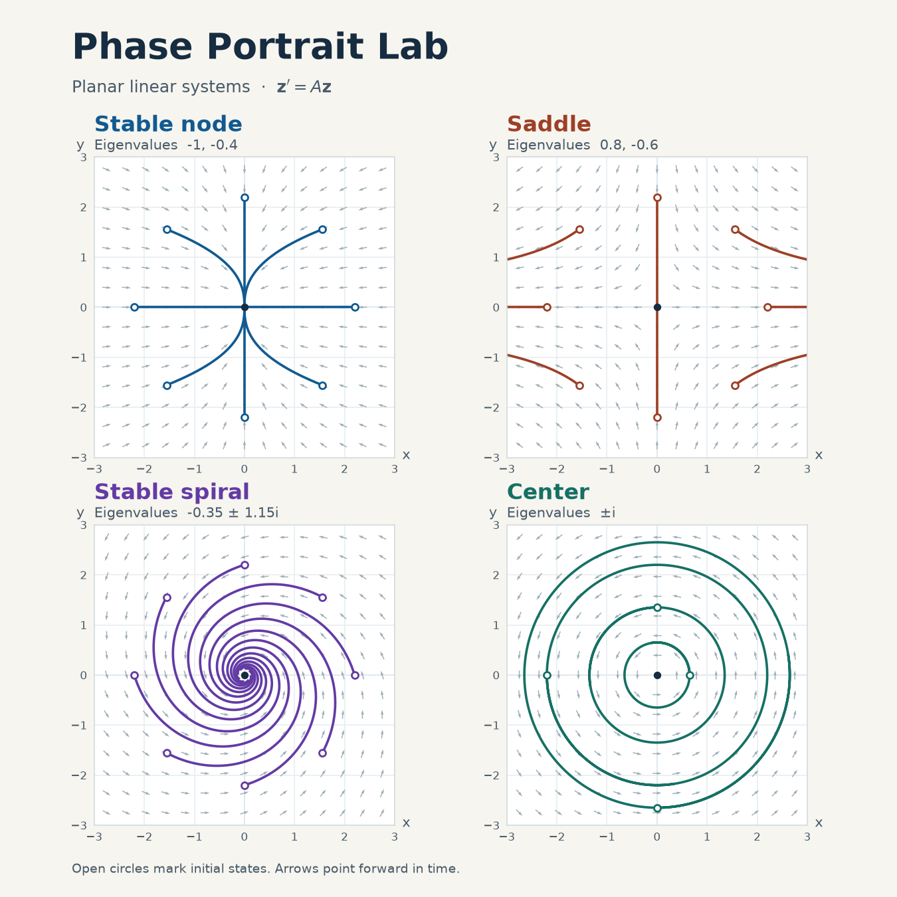

# Phase Portrait Lab

Explore how the eigenvalues of a 2 × 2 matrix shape the trajectories of a linear differential equation. The Python script draws the direction field and approximates forward trajectories using fourth-order Runge–Kutta (RK4).



## Quick start

Use Python 3.10 or newer. Run these commands from the project folder.

```sh
python -m venv .venv
source .venv/bin/activate
python -m pip install -r requirements.txt
python phase_portrait.py
```

On Windows PowerShell, use `.\.venv\Scripts\Activate.ps1` for the activation step. On macOS, use `python3 -m venv .venv` if the `python` command is unavailable.

The gallery is saved to `outputs/phase-portraits.png`. To draw a single preset or supply a matrix in row order, run:

```sh
python phase_portrait.py --preset saddle --output outputs/saddle.png
python phase_portrait.py --matrix -0.35 -1.15 1.15 -0.35 --output outputs/custom.png
```

The custom example represents $x'=-0.35x-1.15y$ and $y'=1.15x-0.35y$. Run `python phase_portrait.py --help` for the other options.

## Reading the plots

| Preset | Eigenvalues | What the trajectories do |
| --- | --- | --- |
| Stable node | −1, −0.4 | Approach the origin along curves that tend toward the slower eigendirection. |
| Saddle | 0.8, −0.6 | Approach the origin on the stable axis. Away from that axis, they eventually move outward. |
| Stable spiral | −0.35 ± 1.15i | Wind counterclockwise toward the origin. |
| Center | ±i | Follow closed orbits around the origin. |

The arrows show the direction of $A\mathbf{z}$ and have equal lengths. The open circles mark the selected initial states, and the dark dot marks the origin. Eigenvalues are computed with NumPy and printed beside the saved figure path.

The labels use a relative tolerance of `1e-9` after dividing the matrix by its largest absolute entry. For a custom system near a stability boundary, check its eigenvalues analytically. The plot is a finite-time numerical illustration. The visible window is $[-3,3]^2$, and `--duration` controls the integration interval. To keep the calculation bounded, the script requires the duration times the largest absolute matrix entry to be at most 40.

## 中文说明

这是一个用 Python 学习二维线性常微分方程 $\mathbf{z}'=A\mathbf{z}$ 的小项目。每幅图将特征值、方向场与数值轨迹放在一起，方便对照课上学到的稳定结点、鞍点、稳定焦点和中心。

运行上面的安装命令后，直接执行 `python phase_portrait.py` 就能生成四种相图。可以把自定义示例中的两个 `-0.35` 同时改成 `0`，观察稳定焦点如何变为中心，再把它们改成 `0.35`，观察轨迹如何向外旋转。
